# ABG-v30: Adaptive Box Subdivision for Budgeted Black-Box Optimization

**An exploratory benchmark across 33 continuous-optimization function families**  
**Author:** Iliya Emam  
**Version:** 1.0 · 19 October 2026  
**Artifact status:** Research report and reproducible benchmark; not peer reviewed

> **Main finding.** On the benchmark suite reported here, ABG-v30 achieved the best mean task rank (2.270), a 74.5% average success rate at normalized gap \(10^{-3}\), and a 65.2% rate at \(10^{-6}\). It ranked among the three best methods on 73 of 87 deterministic function–dimension tasks. These are promising results for this suite, not proof of universal or statistically established superiority: none of 693 paired tests remained significant after global Holm correction.

## Abstract

Black-box optimization is difficult when objective evaluations are limited, derivatives are unavailable or unreliable, and the search landscape contains narrow valleys, poor conditioning, or many local minima. This report introduces **ABG-v30**, an adaptive box-subdivision optimizer designed to balance global exploration with local refinement under a strict objective-evaluation budget. Its implementation combines a priority-heap region scheduler, periodic region audits, an anti-starvation exploration step, a coordinate-balanced polling procedure, an optional validated quadratic surrogate, and bounded multi-start local refinement. The central hypothesis is that these components can make spatial search more resilient than a single, fixed search pattern without assuming that one landscape geometry fits every objective.

We evaluate ABG-v30 against seven derivative-free or gradient-based reference methods on 33 classical function families and 87 deterministic function–dimension tasks. Each deterministic task uses ten paired trials and a maximum budget of 300 counted objective evaluations per run. A separate stress set adds Gaussian observation noise at relative levels of 1% and 5% on six selected functions. Across the deterministic suite, ABG-v30 obtains a mean rank of 2.270, leads the reported average success rates at normalized-gap thresholds of \(10^{-3}\) and \(10^{-6}\), and is in the top three on 73 tasks. In the selected noisy subset, its success rate is 41.7% at 1% relative noise and 27.8% at 5%, under the \(10^{-3}\) threshold. However, all 693 paired Wilcoxon tests are non-significant after global Holm correction, and several baselines were not comprehensively hyperparameter-tuned. The evidence therefore supports ABG-v30 as a promising and testable design, while motivating independent replication and evaluation on an official suite such as COCO/BBOB.

**Keywords:** black-box optimization; derivative-free optimization; adaptive subdivision; global optimization; evaluation budget; surrogate-assisted search; benchmark reproducibility

## 1. Introduction

Many optimization problems provide only a function value for a candidate solution. Objective calls may be expensive, gradients may be unavailable, and the landscape may be poorly scaled or highly multimodal. Under a limited call budget, a method must decide not only where to search, but also when to exploit a promising region and when to revisit less recently explored regions.

ABG-v30 is motivated by this allocation problem. Instead of relying on a single global sampling strategy or a purely local trajectory, it partitions a bounded domain into regions and repeatedly chooses regions for refinement. It supplements this spatial search with explicit coverage mechanisms and optional local improvement. The design is intended to address practical failure modes that can occur in budgeted optimization: repeatedly refining the current best region, neglecting parts of the domain, over-trusting a surrogate fitted from sparse observations, or spending the remaining budget on only a subset of coordinates.

This work is an **experimental study of a ABG-v30 optimizer**, not a claim that all of its mechanisms are new in isolation. The contribution is the particular ABG-v30 implementation, the way its components are integrated under a common evaluation cap, and the benchmark evidence presented for that implementation.

### 1.1 Research questions

The benchmark is organized around four questions:

1. **Aggregate performance:** Does ABG-v30 achieve competitive normalized optimality gaps across convex, ill-conditioned, non-convex, shifted, rotated, and multimodal landscapes?
2. **Budgeted search:** How does it compare when each method receives the same maximum number of counted objective evaluations?
3. **Robustness:** Does its observed performance persist on a small stress set with additive Gaussian observation noise?
4. **Evidence strength:** Are the apparent differences supported by paired statistical tests after correcting for multiple comparisons?

### 1.2 Contributions

1. **An integrated adaptive search procedure.** ABG-v30 combines region subdivision and priority scheduling with separate mechanisms for stale-region exploration, periodic audits, coordinate-balanced polling, optional surrogate proposals, and bounded local refinement.
2. **A broad function-based test matrix.** The released suite covers 33 function families and 87 deterministic function–dimension tasks, including shifted/rotated and ill-conditioned cases, with dimensions up to 30 for scalable functions.
3. **A common evaluation cap and paired design.** Eight methods are compared on matched function instances and trial indices, with at most 300 counted objective evaluations per run and raw run-level results preserved.
4. **An auditable research artifact.** Code, benchmark metadata, per-run CSV data, aggregate tables, statistical tests, a standalone dashboard, convergence plots, and 33 landscape visualizations are included.

### 1.3 Intuition in one minute

Think of the bounded search domain as a set of boxes competing for a limited number of objective evaluations. ABG-v30 keeps splitting a selected box into smaller boxes and samples their centers. Its scheduler balances four signals: how good a box's best observed point is relative to the current incumbent, the box's size, how long it has waited since selection, and how sparsely it has been sampled. A separate age-based queue periodically forces attention toward an older region, so the current best-looking area does not receive every subdivision.

The box search is only one phase. Later phases may propose a point from a validated quadratic approximation, run bounded local refinements from diverse starts, and probe balanced coordinate directions around the current best point. Each proposal is charged to the same hard evaluation budget. The intended benefit is not a guarantee of finding a global optimum; it is a practical allocation strategy that combines broad spatial search with several opportunities for local improvement.

## 2. ABG-v30 Method

### 2.1 Design overview

ABG-v30 maintains a collection of active axis-aligned regions over the normalized search domain \([-1,1]^d\). Initial points are selected through a space-filling Sobol design, with an optional objective-agnostic center anchor replacing one design point rather than increasing the initial evaluation count. The initial observations are associated with the root region, which is then refined adaptively.

At each subdivision step, a region is selected using a priority scheduler. The implementation uses a heap for the region-priority queue and periodically refreshes priority scales and scores. The region with the widest coordinate extent is split, and the child regions are tested at their centers. If a child center is a previously cached point and therefore does not provide new deterministic evidence, the implementation attempts a fresh interior point before treating that child as resolution-limited.

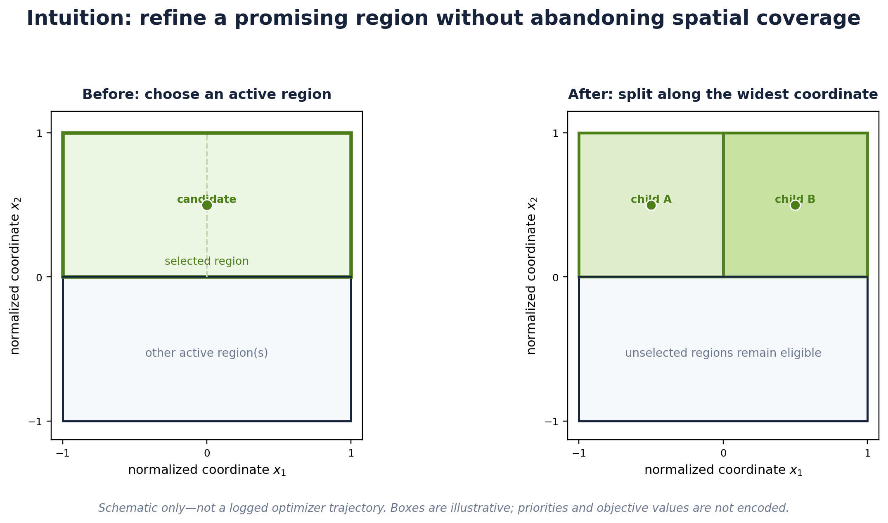

*Figure 1. Intuition for region refinement. The highlighted box is split along its widest coordinate; untouched regions remain eligible for later selection. This is an explanatory schematic, not a trace of an actual run, and the shading does not encode measured objective values.*

### 2.2 Exploration and region auditing

A priority-only policy can repeatedly select the same attractive part of the search space. ABG-v30 therefore has an independent age-based exploration queue: every fifth split, the scheduler selects a stale active region rather than always following the highest current priority score. A separate audit queue periodically re-samples older regions. These mechanisms are intended to reduce region starvation and provide additional evidence about regions that have not recently been revisited.

For precision, the implementation's region priority is the weighted score

\[
S(R)=0.36q(R)+0.24d(R)+0.24a(R)+0.16u(R),
\]

where \(q(R)=\exp[-\min(\max(f_R-f_{\mathrm{best}},0)/s_f,60)]\) measures the region's best observed value relative to the global incumbent, \(d(R)=\min(1,\operatorname{diag}(R)/(2\sqrt{d}))\) rewards spatial extent, \(a(R)=\min(1,\max(0,t-t_R)/12)\) represents age since selection, and \(u(R)=1/\sqrt{1+n_R}\) gives a larger score to a region with fewer recorded samples. Here \(s_f\) is refreshed every 16 splits using the larger of the observed objective-value interquartile range, one quarter of its standard deviation, and a small numerical floor. The priority heap is rebuilt every 32 splits; age-based exploration is scheduled every fifth split, and the separate oldest-region audit is attempted every seventh split. These coefficients and intervals describe this implementation, not universal constants.

### 2.3 Optional surrogate proposal

The implementation can fit a quadratic surrogate to the initial design. When the number of observations is insufficient for a full quadratic model, it falls back to a diagonal quadratic model if the sample size permits. An 80/20 train/hold-out split is used for validation. A proposed surrogate center is accepted only when the fit passes the implementation's hold-out criterion, the estimated quadratic curvature is suitable, and the candidate lies inside the normalized domain. In the current implementation, the hold-out \(Q^2\) threshold is 0.70. The surrogate is optional; a failed fit does not prevent the rest of ABG-v30 from running.

This gate matters because a surrogate can be misleading when observations are sparse, noisy, or strongly non-quadratic. Surrogate-based global optimization is an established research area [8]; ABG-v30’s specific hold-out gate and integration are implementation choices, not a claim that surrogate optimization itself is new. ABG-v30 treats the surrogate as one possible proposal source, not as a replacement for the underlying region search.

### 2.4 Local refinement and balanced polling

After the region-search stage, ABG-v30 may run bounded multi-start L-BFGS-B refinements from diverse candidate points. No user-supplied gradient is required; in the included implementation, local optimization can obtain derivative estimates through objective evaluations, which are counted by the shared oracle. Part of the remaining evaluation budget is reserved for a final polling stage around the incumbent. The polling directions include a randomly permuted pass across all coordinate axes with opposite signs, followed by a small set of normalized random directions. The poll is attempted at multiple radii, and its center is updated immediately when a better point is found.

The coordinate-balanced construction is designed to avoid a simple ordering bias in which a low budget repeatedly visits only the first coordinates. It does not guarantee coordinate-invariant performance; rather, it removes one avoidable implementation-level source of axis starvation.

### 2.5 High-level pseudocode

```text
Input: bounded objective f, evaluation budget B
1. Create a space-filling initial design; optionally replace one point with the domain center.
2. Evaluate the design and initialize a root region.
3. While budget remains for global exploration:
   a. Refresh region-priority scales/scores periodically.
   b. Choose a region by priority, except on scheduled exploration steps.
   c. Split the region along its widest coordinate.
   d. Evaluate child centers; use a fresh interior fallback if a center is cached.
   e. Periodically audit an older active region.
4. If enabled, fit and validate a quadratic surrogate; probe its candidate only if accepted.
5. If enabled, perform budgeted bounded local refinement from diverse starts.
6. If enabled, poll balanced coordinate/random directions around the incumbent.
Output: best evaluated candidate under the common evaluation cap.
```

This pseudocode is a conceptual summary; the source code defines the exact scheduling, reserves, cache policy, stopping conditions, and accounting.


*Figure 2. High-level workflow of the released ABG-v30 implementation. The surrogate, local-refinement, and balanced-polling stages are configurable. Exact budget reserves and edge cases are defined by the source code.*

## 3. Experimental Design

### 3.1 Test suite

The deterministic suite contains **33 function families** and **87 function–dimension tasks**. Twenty-seven scalable entries are evaluated at dimensions 2, 10, and 30. Six special functions use their natural fixed dimensions (five two-dimensional functions and one four-dimensional Powell singular case). Function families include:

- smooth convex baselines such as Sphere and Zakharov;
- ill-conditioned convex landscapes such as Ellipsoid, Bent Cigar, and Discus;
- narrow-valley objectives such as Rosenbrock and rotated Rosenbrock;
- multimodal objectives such as Rastrigin, Ackley, Griewank, Schwefel, Levy, and Styblinski–Tang;
- shifted and rotated instances intended to reduce reliance on a single coordinate orientation or optimum location;
- special low-dimensional landscapes such as Beale, Himmelblau, Michalewicz, Cross-in-Tray, and Eggholder.

The 2-D landscape images are visualization slices, not full representations of higher-dimensional geometry. Each scalable-function image shows one slice with coordinates 3 through \(d\) fixed at zero and a second slice with those coordinates fixed at the known minimizer. Scores are computed from full-dimensional runs, not from the images.

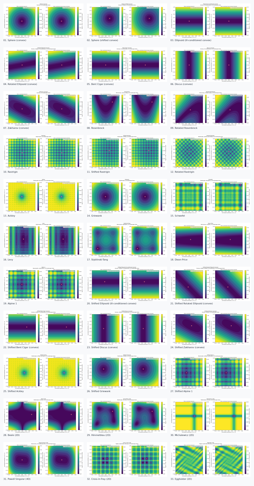

*Figure 3. Landscape atlas for the 33 test functions. The color scale uses a log-transformed, dimensionless objective gap for visualization; it does not affect optimizer scores.*

### 3.2 Compared algorithms

Eight methods are included. ABG-v30 is the proposed method; the other seven are comparison baselines included to cover global partitioning, evolutionary, annealing, low-discrepancy multi-start, local-search, and adaptive first-order styles.

| Method | Role in this benchmark | Important qualification |
|---|---|---|
| **ABG-v30** | Adaptive box subdivision with optional validated quadratic proposal, bounded local refinement, and balanced polling | Method under study |
| DIRECT | Deterministic partitioning of a bounded domain | Standard implementation in the bundled harness |
| CMA-ES (compact implementation) | Covariance-adaptation evolutionary search | Compact implementation, not claimed to be the best possible CMA-ES configuration |
| Differential Evolution | Population-based mutation and recombination | Settings are disclosed in code; no exhaustive hyperparameter search |
| Dual Annealing | Stochastic global search with annealing and optional local search | Settings are disclosed in code; no exhaustive hyperparameter search |
| Sobol + L-BFGS-B | Low-discrepancy starts with bounded local refinements | Multi-start budget is capped by the same oracle |
| Powell multi-start | Derivative-free local search from multiple Sobol starts | Restart count is budget-limited |
| Adam (finite-difference, lr = 0.03) | Adam-style updates using finite-difference gradient estimates | Fixed learning rate; explicitly **not** reported as tuned |

The inclusion of different algorithm families is intended to provide a useful exploratory comparison, not to imply that each baseline is represented by its strongest published or fully tuned implementation. In particular, the CMA-ES implementation is compact and parameter tuning is not comprehensive.

### 3.3 Budget, seeds, and pairing

Each deterministic function–dimension task uses **10 trials** for every method. This yields \(87\times10\times8=6{,}960\) deterministic run records. Every run has a hard cap of **300 counted objective evaluations**. This is a common maximum budget, not a guarantee that each method consumes exactly 300 evaluations: methods can stop early, and exact deterministic duplicate points may be served by the common cache without another objective evaluation. Noisy objective evaluations are not cached.

The same generated test instance and trial index are used when comparing methods, so the statistical comparisons are paired. All methods operate in the same normalized bounded domain \([-1,1]^d\); the benchmark code performs the function-specific coordinate transformations.

### 3.4 Objective normalization and success thresholds

To compare functions with very different native scales, the benchmark estimates a function-instance reference scale from 256 Sobol points generated before optimization. Specifically, the scale is the median absolute deviation of those reference objective values from the supplied reference minimum, with a fallback for degenerate values.

For a returned point \(x\), the normalized gap is

\[
  g(x)=\frac{\max(0, f(x)-f^*)}{s_{\mathrm{ref}}},
\]

where \(f^*\) is the benchmark's global-minimum reference value and \(s_{\mathrm{ref}}\) is the fixed instance-specific reference scale. A run is successful at threshold \(\epsilon\) if \(g(x)\le\epsilon\). We report \(10^{-3}\) and \(10^{-6}\) thresholds. The same scale is used for every algorithm on an instance. For noisy optimization, the candidate selected under noisy observations is re-scored with the clean objective for evaluation; the scoring call is an audit operation and is excluded from the optimizer budget for all methods.

### 3.5 Noisy stress test

A separate stress set uses six selected functions—shifted Sphere, rotated Ellipsoid, Rosenbrock, shifted Rastrigin, Ackley, and Schwefel—in dimension 10. It tests additive Gaussian observation noise at relative levels \(\sigma=0.01s_{\mathrm{ref}}\) and \(\sigma=0.05s_{\mathrm{ref}}\), with six trials per function and noise level. This adds \(6\times2\times6\times8=576\) run records. The noisy set is intentionally a **small stress test**, not a comprehensive noise benchmark.

### 3.6 Statistical analysis

The main ranking is calculated in two stages. First, within each deterministic function–dimension task, methods are ranked by the median normalized gap across the ten trials (lower is better). Second, those task-level ranks are averaged over all 87 tasks. Mean rank summarizes breadth of performance; it is not a hypothesis test. We also report threshold success, top-three task count, median wall-clock time, budget utilization, performance profiles, and paired win/loss/tie counts.

Paired Wilcoxon signed-rank tests [6] compare ABG-v30 and each competitor on the same trial indices using log-transformed normalized gaps. P-values are corrected globally across the full family of tested function/dimension/noise comparisons using Holm’s step-down procedure [7]. Statistical significance is assessed at 0.05 after correction.

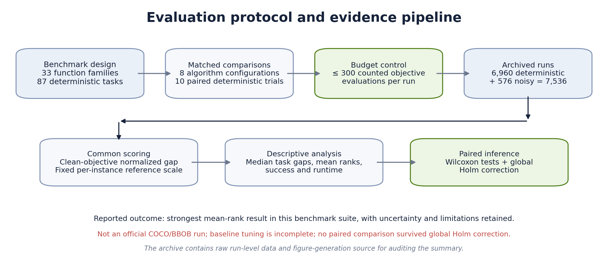

*Figure 4. From benchmark design through the archived run-level outcomes to common scoring, descriptive aggregation, and paired inference. This diagram summarizes the current experiment and makes its main caveats explicit.*

## 4. Results

### 4.1 Aggregate ranking

ABG-v30 achieved the best mean rank in this particular suite (2.270). Its average success rates were 74.5% at normalized gap \(10^{-3}\) and 65.2% at \(10^{-6}\), and it appeared in the top three on 73 of 87 deterministic tasks. This pattern is consistent with the intended aim of combining broad region search with local refinement: the method's aggregate performance is not limited to a single function class in this suite.


*Figure 5. Aggregate mean rank across the 87 deterministic function–dimension tasks. Lower is better. The bar chart is descriptive and should be read together with success rates and paired tests.*

| Rank | Algorithm | Mean rank ↓ | Mean success \(g\le10^{-3}\) | Mean success \(g\le10^{-6}\) | Median task-level run time (s) | Top-three tasks |
|---:|---|---:|---:|---:|---:|---:|
| 1 | **ABG-v30** | **2.270** | **74.5%** | **65.2%** | 0.0310 | **73 / 87** |
| 2 | Dual Annealing | 3.046 | 60.5% | 47.1% | 0.0128 | 57 / 87 |
| 3 | DIRECT | 3.057 | 62.0% | 52.4% | 0.0068 | 58 / 87 |
| 4 | CMA-ES (compact implementation) | 4.609 | 40.2% | 18.6% | 0.0106 | 19 / 87 |
| 5 | Sobol + L-BFGS-B | 5.144 | 42.2% | 27.1% | 0.0160 | 19 / 87 |
| 6 | Powell multi-start | 5.425 | 41.0% | 24.3% | 0.0131 | 21 / 87 |
| 7 | Differential Evolution | 6.057 | 41.6% | 21.1% | 0.0147 | 5 / 87 |
| 8 | Adam (finite-difference, lr = 0.03) | 6.391 | 31.5% | 8.7% | 0.0071 | 9 / 87 |

*Table 1. Results on the deterministic suite. Mean rank is computed from per-task median normalized gaps. Success rates are averages across the 87 tasks. Times are environment-dependent and are shown as a separate efficiency measure; ABG-v30 was not the fastest method.*

The strongest defensible interpretation is that ABG-v30 is **highly competitive on this suite and particularly strong in aggregate solution quality**. Its mean rank is about 0.78 rank positions lower than the next method, Dual Annealing, and its mean success rate is 14.0 percentage points higher at \(10^{-3}\) and 18.0 points higher at \(10^{-6}\). That aggregate advantage merits further investigation; it should not be conflated with statistical proof of superiority.

### 4.2 Performance across landscape families

Performance differs across function families, which is why the aggregate ranking is not the only result. Convex and ill-conditioned problems test scaling; narrow-valley functions test coordinated progress; multimodal landscapes test basin discovery; shifted and rotated instances test sensitivity to a particular origin or coordinate system.

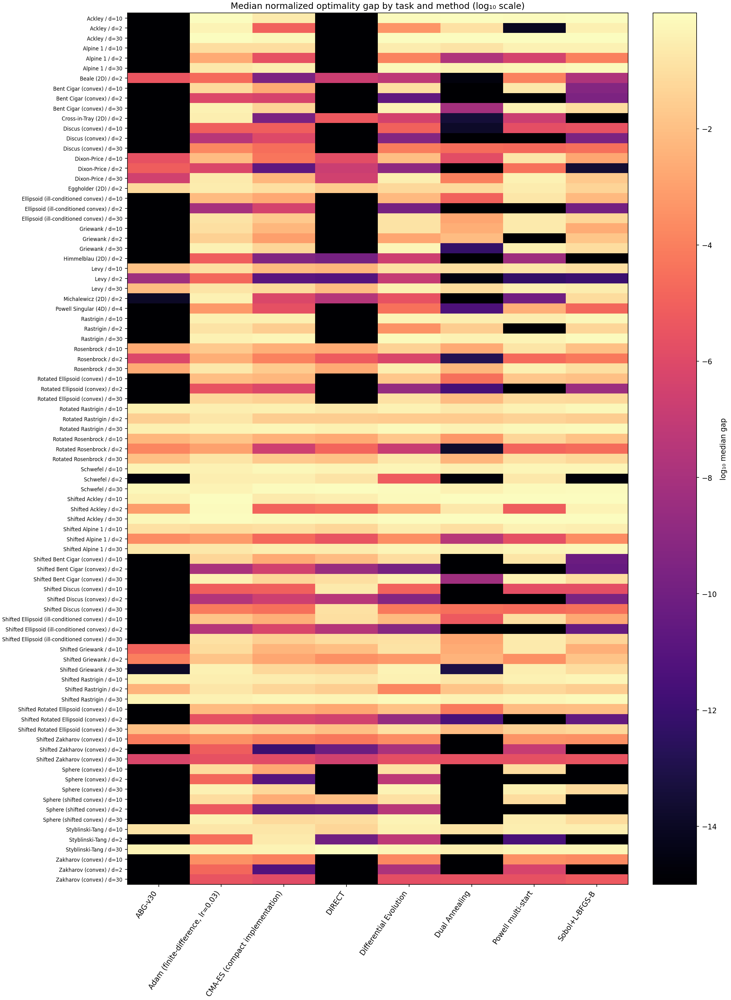

*Figure 6. Median normalized gap on every deterministic function–dimension task. Color represents the logarithm of the median gap; lower gaps are better. The raw data preserve all ten individual trials per cell.*

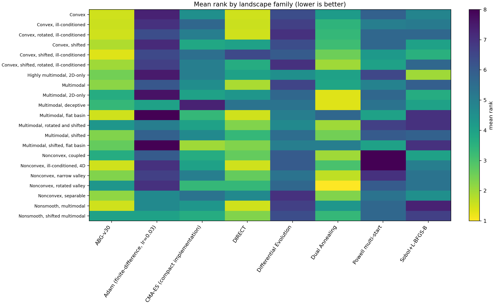

*Figure 7. Mean rank by landscape category. This view helps distinguish a broad aggregate result from a result driven by just one function family.*

### 4.3 Performance profile and convergence

A performance-profile-style plot shows the fraction of tasks for which each method's median gap is within a factor \(\tau\) of the best method on that task. The plot complements mean rank by showing how widely a method remains competitive as the allowed ratio changes.

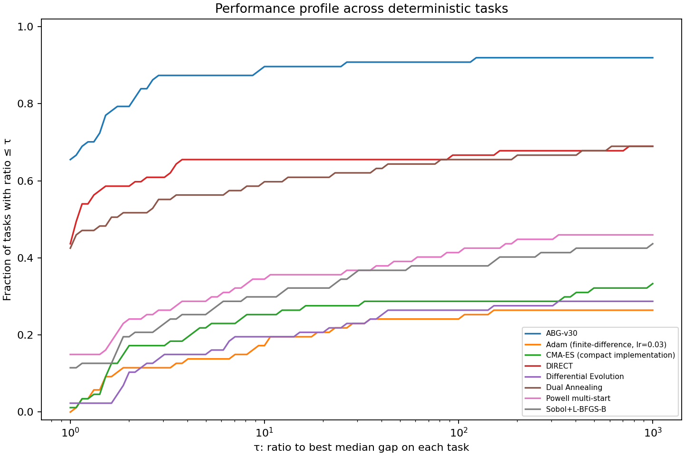

*Figure 8. Fraction of tasks for which a method's median gap is at most \(\tau\) times the best median gap on that task. The comparison uses deterministic task-level medians.*

The benchmark also includes best-so-far traces for representative landscapes: shifted convex Sphere, Rosenbrock, Rastrigin, 10-D Schwefel, and 30-D rotated Ellipsoid. They show the trajectory of the best observed normalized gap as evaluations are consumed, rather than only the final score.

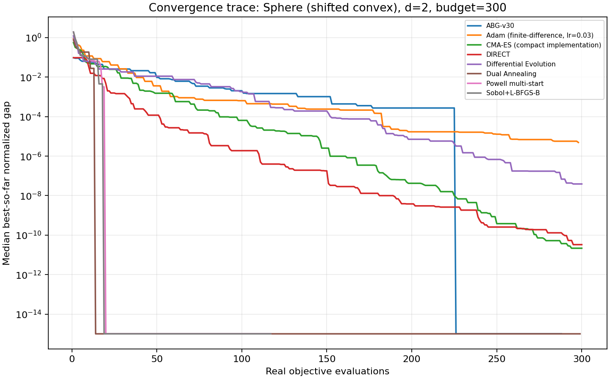

*Figure 9a. Convergence on shifted Sphere, 2-D.*

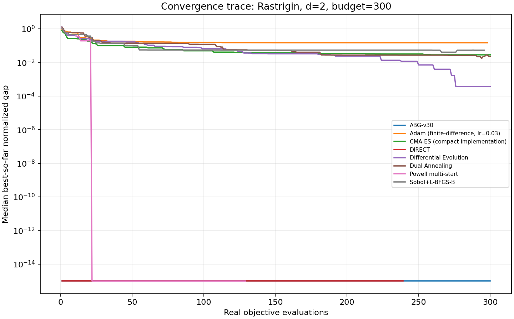

*Figure 9b. Convergence on Rastrigin, 2-D.*

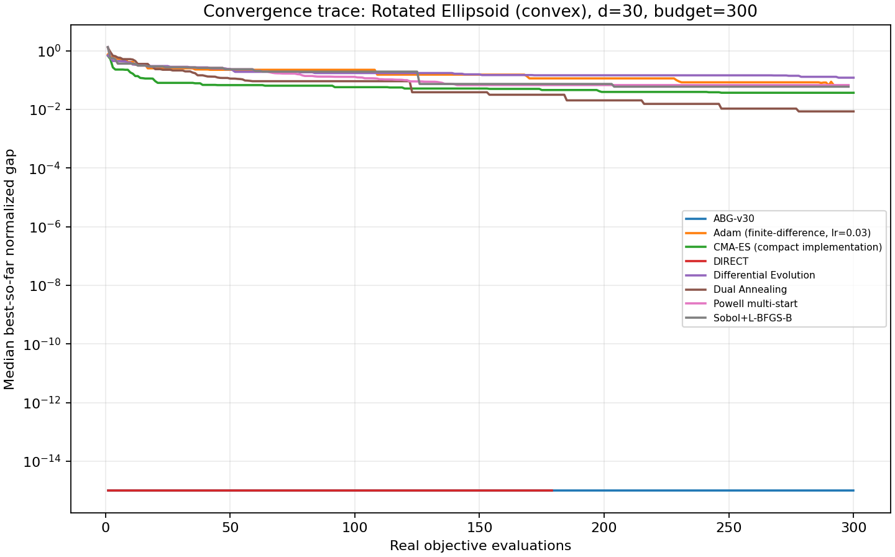

*Figure 9c. Convergence on rotated Ellipsoid, 30-D.*

### 4.4 Noisy stress test

In the selected noisy stress subset, ABG-v30 had a success rate of 41.7% at 1% relative noise and 27.8% at 5% relative noise under the \(10^{-3}\) normalized-gap threshold. DIRECT reached 22.2% and 8.3%, respectively; the other six methods recorded no successful runs at that threshold in these small noisy samples. Each method/noise-level aggregate contains 36 runs (six functions times six trials).

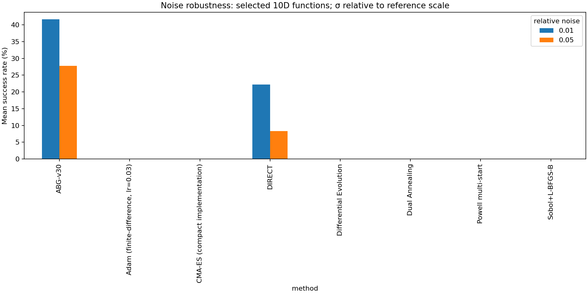

*Figure 10. Threshold success under selected additive Gaussian-noise conditions. These results are promising for ABG-v30, but are based on only 36 runs per method and noise level and should be treated as exploratory.*

### 4.5 Paired statistical evidence

ABG-v30 has more paired wins than losses against each baseline in the deterministic run-level comparisons, with ties retained rather than removed. For example, against DIRECT, there are 340 ABG wins, 208 losses, and 322 ties across 870 paired outcomes. The other pairwise summaries are available in `ABG_top8_benchmark/paired_tests_vs_ABG.csv`.

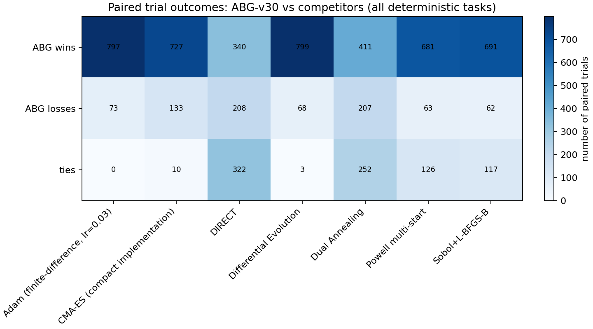

*Figure 11. Paired trial outcome counts for ABG-v30 against each competitor, aggregated across deterministic tasks. A win/loss count is descriptive and does not itself establish statistical significance.*

Across 693 paired Wilcoxon tests spanning deterministic and noisy task settings, **no comparison remained significant after the global Holm correction at 0.05**. Ten trials per task provide limited power, and multiple-comparison correction is intentionally conservative. Thus, the results do not establish that ABG-v30 is statistically superior to every baseline. They do establish a strong descriptive signal within this particular suite that warrants replication with more trials and better-tuned reference implementations.

### 4.6 Runtime and budget trade-offs

ABG-v30's median task-level runtime was 0.0310 seconds, slower than DIRECT (0.0068 seconds) and the fixed-learning-rate Adam implementation (0.0071 seconds) in this environment. Its advantage in this benchmark is therefore not raw wall-clock speed. The relevant trade-off is solution quality under an objective-evaluation cap; runtime should be re-measured on the target machine and on expensive objective functions before drawing application-specific conclusions.

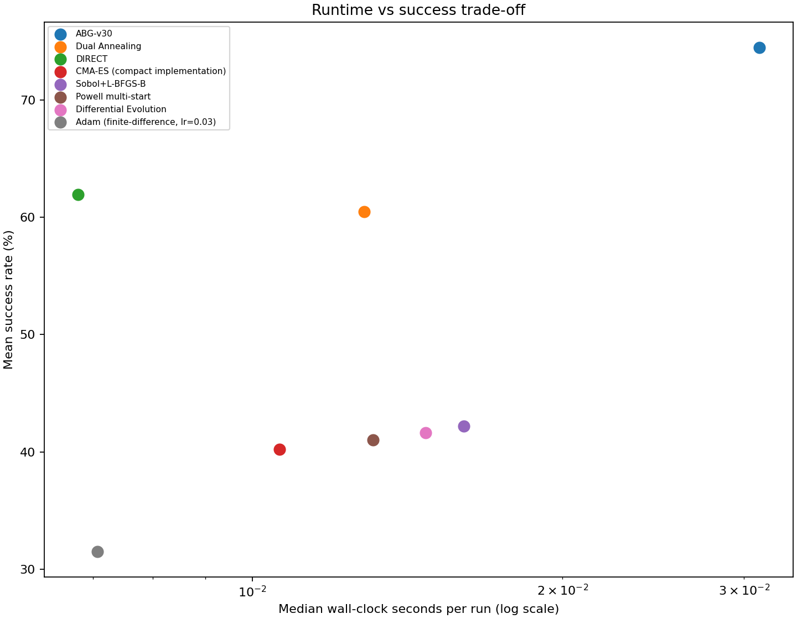

*Figure 12. Runtime–success trade-off. Wall-clock timings depend on the software stack and hardware.*

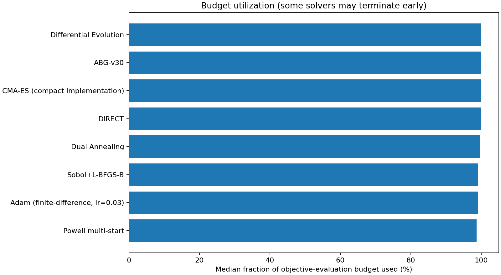

*Figure 13. Median utilization of the 300-evaluation budget. The cap is common, but not every solver consumes the full allowance on every run.*

## 5. Discussion

The findings suggest three practical strengths of the ABG-v30 design, within the bounds of this experiment.

First, **the method combines multiple sources of search information**. The box scheduler allocates evaluations among regions; age-based exploration and audits provide mechanisms for revisiting underexplored areas; local refinement improves candidate solutions; and balanced polling gives the final budget a chance to test all coordinate axes. This combination is a plausible reason to investigate ABG-v30 further, especially in settings where a rigid single search pattern can miss useful regions.

Second, **the optional surrogate is guarded rather than blindly trusted**. A hold-out check and feasibility/curvature checks aim to prevent a low-quality quadratic model from steering the search. The full implementation keeps the surrogate optional, so the central algorithm does not require every objective to look quadratic.

Third, **the high-dimensional implementation includes explicit safeguards against coordinate-order bias and region starvation**. These safeguards are important engineering choices under a limited budget. They do not guarantee that the method is invariant to rotations or that it scales favorably on every problem, which remains an empirical question.

The current results also identify clear targets for the next iteration: stronger reference tuning, more independent trials, full official COCO/BBOB evaluation, additional budgets, ablation experiments on the same test matrix, and expensive real objectives. A useful follow-up study should preregister the benchmark protocol and run the comparison on a clean machine and a separate evaluator before making broad claims.

## 6. Limitations and Threats to Validity

1. **The suite is not the official COCO/BBOB implementation.** It uses classical analytic function families and selected shifted/rotated variants. It is useful for exploratory development but should not be presented as an official BBOB result [1].
2. **Baseline tuning is incomplete.** Adam uses a fixed learning rate of 0.03 and is not tuned; the included CMA-ES is a compact implementation; the remaining baselines also have disclosed settings but were not comprehensively searched over hyperparameters. The results compare these bundled configurations, not the theoretical best performance of each algorithm.
3. **Trial counts are modest.** Ten trials per deterministic task and six trials per noise/function/level combination can miss variability and reduce statistical power.
4. **No adjusted paired test is significant.** Although ABG-v30 leads aggregate descriptive metrics, the 693 tests did not produce a statistically significant result after global Holm correction. The rankings must be interpreted as hypothesis-generating evidence.
5. **Timing is environment-specific.** Python overhead, libraries, CPU, and implementation details affect runtime. Timing is reported separately from objective-evaluation quality.
6. **Visualization is a slice.** A two-dimensional slice cannot reveal all structure of a 10-D or 30-D landscape. All optimization scores come from the full-dimensional objective.
7. **Reference minima and scaling are benchmark assumptions.** The scoring depends on the supplied \(f^*\) and a per-instance Sobol reference scale. These values and the scale computation are available in the source and raw CSV outputs.
8. **No claim of application-level validation is made.** The study evaluates synthetic continuous optimization functions, not neural-network training, hyperparameter optimization on real workloads, engineering simulations, or constrained optimization.

## 7. Conclusion

ABG-v30 is an adaptive box-subdivision approach that couples priority-guided regional search with anti-starvation exploration, region audits, an optional validated quadratic proposal, bounded local refinement, and coordinate-balanced polling. On the released benchmark of 33 function families and 87 deterministic function–dimension tasks, it achieved the best mean rank (2.270), the highest aggregate success rates among the tested configurations at the two reported thresholds, and top-three placement on 73 tasks. The selected noisy stress test also favored ABG-v30 in observed threshold success, though that subset is small.

The correct conclusion is **promising, not proven**. The absence of significant results after global Holm correction and the limited tuning of the baselines mean that ABG-v30 should be treated as a strong research candidate for independent replication, not as a universally superior optimizer. The released code, per-run data, figures, and paired analyses are intended to make that next step straightforward. The benchmark should be read as evidence about the eight bundled configurations on this test matrix, not as a ranking of the best possible implementations of every named algorithm.

## Data and Code Availability

The complete benchmark source is `benchmark_top8_20plus.py`; the ABG-v30 implementation is `ABG_research_v30.py`. The artifact identifies its author as Iliya Emam and does not claim an institutional affiliation. Run-level outcomes are stored in `ABG_top8_benchmark/raw_results.csv`. Aggregate tables, paired tests, metadata, convergence traces, the standalone HTML dashboard, and all 33 landscape figures are included in the repository.

To reproduce the report from the included complete data without rerunning optimization:

```bash
python benchmark_top8_20plus.py --finalize-only
```

The script uses the `ABG_top8_benchmark` folder adjacent to the source files. For a clean full rerun, preserve a copy of the distributed results, move the existing output folder out of the project directory, and execute the benchmark in a clean copy of the repository. In environments with per-command execution limits, use `--max-runs` repeatedly to resume from checkpoints.

## References

[1] S. Finck, N. Hansen, R. Ros, and A. Auger, “Real-Parameter Black-Box Optimization Benchmarking 2009: Noiseless Functions Definitions,” INRIA Research Report RR-6829, 2009. [COCO BBOB benchmark overview](https://coco-platform.org/testsuites/bbob/overview.html); [technical report](https://inria.hal.science/inria-00362633v2/document).

[2] E. D. Dolan and J. J. Moré, “Benchmarking optimization software with performance profiles,” *Mathematical Programming*, vol. 91, pp. 201–213, 2002. [https://doi.org/10.1007/S101070100263](https://doi.org/10.1007/S101070100263).

[3] SciPy Community, “`scipy.optimize.differential_evolution` documentation.” [https://docs.scipy.org/doc/scipy/reference/generated/scipy.optimize.differential_evolution.html](https://docs.scipy.org/doc/scipy/reference/generated/scipy.optimize.differential_evolution.html).

[4] SciPy Community, “`scipy.optimize.dual_annealing` documentation.” [https://docs.scipy.org/doc/scipy/reference/generated/scipy.optimize.dual_annealing.html](https://docs.scipy.org/doc/scipy/reference/generated/scipy.optimize.dual_annealing.html).

[5] N. Hansen and A. Ostermeier, “Completely derandomized self-adaptation in evolution strategies,” *Evolutionary Computation*, vol. 9, no. 2, pp. 159–195, 2001. [https://doi.org/10.1162/106365601750190398](https://doi.org/10.1162/106365601750190398).

[6] F. Wilcoxon, “Individual Comparisons by Ranking Methods,” *Biometrics Bulletin*, vol. 1, no. 6, pp. 80–83, 1945. [https://doi.org/10.2307/3001968](https://doi.org/10.2307/3001968).

[7] S. Holm, “A Simple Sequentially Rejective Multiple Test Procedure,” *Scandinavian Journal of Statistics*, vol. 6, no. 2, pp. 65–70, 1979. [https://www.jstor.org/stable/4615733](https://www.jstor.org/stable/4615733).

[8] D. R. Jones, M. Schonlau, and W. J. Welch, “Efficient Global Optimization of Expensive Black-Box Functions,” *Journal of Global Optimization*, vol. 13, pp. 455–492, 1998. [https://doi.org/10.1023/A:1008306431147](https://doi.org/10.1023/A:1008306431147).

## Supplementary Results

- [Detailed machine-generated benchmark report](ABG_top8_benchmark/report.md)
- [Overall ranking CSV](ABG_top8_benchmark/overall_ranking.csv)
- [Paired tests and Holm-adjusted p-values](ABG_top8_benchmark/paired_tests_vs_ABG.csv)
- [Per-task summaries](ABG_top8_benchmark/summary_by_function_dimension.csv)
- [Run-level raw outcomes](ABG_top8_benchmark/raw_results.csv)
- [All figures and landscape slices](ABG_top8_benchmark/plots/)
- [Standalone offline dashboard](ABG_top8_benchmark/index.html)
