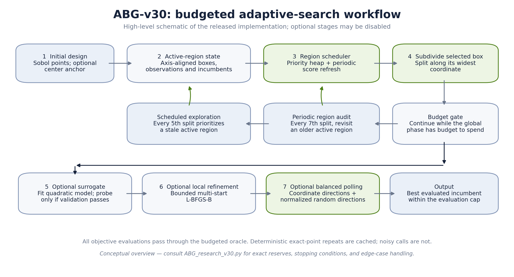
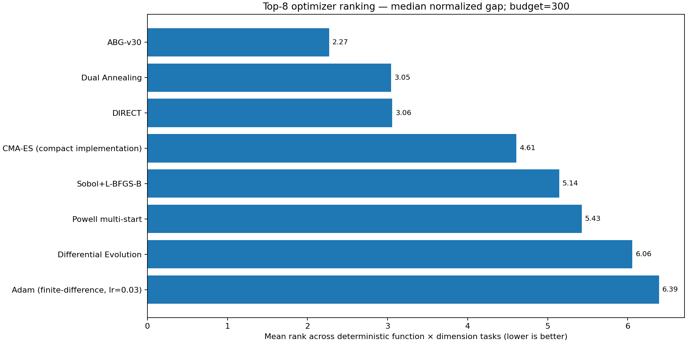

# ABG-v30 — Adaptive Box Subdivision for Budgeted Black-Box Optimization

**Author:** Iliya Emam  
**Research artifact · 33 benchmark function families · 8 optimizer configurations · reproducible run-level data**

ABG-v30 is a derivative-free optimization approach that combines adaptive box subdivision with priority scheduling, periodic region audits, scheduled exploration, an optional validated quadratic surrogate, bounded local refinement, and coordinate-balanced polling. This repository records an exploratory comparison under a common evaluation budget.

> **Headline result:** ABG-v30 ranked first by mean task rank (**2.270**) across 87 deterministic function–dimension tasks and had the highest aggregate success rates at normalized-gap thresholds of \(10^{-3}\) (**74.5%**) and \(10^{-6}\) (**65.2%**) among the eight bundled configurations. It was top-three on 73/87 tasks. **None of 693 paired tests remained significant after global Holm correction**, so treat the result as promising evidence for further testing—not proof of universal superiority.

## Start here

1. Read the [research article](PAPER.md) for the method, intuitive explanation, protocol, results, limitations, and references.
2. View the [ABG-v30 workflow](ABG_top8_benchmark/plots/abg_v30_workflow.png), [overall ranking chart](ABG_top8_benchmark/plots/01_overall_ranking.png), and [33-function landscape atlas](ABG_top8_benchmark/plots/landscape_contact_sheet.png).
3. Open the [offline HTML dashboard](ABG_top8_benchmark/index.html) for the complete interactive chart suite.
4. Inspect the [raw run-level CSV](ABG_top8_benchmark/raw_results.csv), [aggregate ranking](ABG_top8_benchmark/overall_ranking.csv), and [paired statistical tests](ABG_top8_benchmark/paired_tests_vs_ABG.csv).
5. Follow the [Persian GitHub publishing guide](راهنمای_فارسی_انتشار.md) for the exact upload order and final checks, and see [the artifact audit](ARTIFACT_AUDIT.md) for packaging validations.





## Main findings

The main result is descriptive: ABG-v30 leads the average rank and the two reported threshold-success metrics in this benchmark, while remaining slower than some reference configurations in the measured environment. The paper retains the negative statistical result and the limits of the current suite.

| Metric | ABG-v30 result | Interpretation |
|---|---:|---|
| Mean task rank | **2.270** | Best aggregate rank in this suite |
| Mean success at normalized gap ≤ 10⁻³ | **74.5%** | Highest reported among these configurations |
| Mean success at normalized gap ≤ 10⁻⁶ | **65.2%** | Highest reported among these configurations |
| Top-three placements | **73 / 87 tasks** | Strong broad coverage across this benchmark |
| Median task-level runtime | 0.0310 s | Slower than DIRECT in this environment; timings are hardware/software dependent |
| Significant paired tests after global Holm correction | **0 / 693** | The current evidence does not establish statistically significant superiority |

## Benchmark design

- **33 function families** covering smooth convex, ill-conditioned, shifted/rotated, narrow-valley, nonsmooth and multimodal landscapes.
- **87 deterministic function–dimension tasks**, including scalable problems at dimensions 2, 10, and 30 and six fixed-dimensional special cases.
- **8 methods:** ABG-v30, DIRECT, compact CMA-ES, Differential Evolution, Dual Annealing, Sobol + L-BFGS-B, Powell multi-start, and finite-difference Adam (learning rate 0.03, not tuned).
- **10 paired trials per deterministic task**, with a hard cap of 300 counted objective evaluations per run.
- **Noise stress set:** six selected 10-D functions, Gaussian noise at 1% and 5% of a fixed per-instance reference scale, six trials per function/noise level.
- **7,536 run records:** 6,960 deterministic and 576 noisy.

This is a classical-function exploratory suite, **not an official COCO/BBOB run**. Baseline tuning is not exhaustive, and the statistical tests did not survive global Holm correction. Full details are in [PAPER.md](PAPER.md).

## Repository contents

```text
.
├── README.md
├── PAPER.md
├── KAGGLE_PAGE.md
├── PUBLISHING_GUIDE.md
├── FIGURE_PLACEMENT_GUIDE.md
├── CITATION.cff
├── ARTIFACT_AUDIT.md
├── راهنمای_فارسی_انتشار.md
├── LICENSE_DECISION.md
├── requirements.txt
├── benchmark_top8_20plus.py
├── ABG_research_v30.py
└── ABG_top8_benchmark/
    ├── index.html
    ├── raw_results.csv
    ├── summary_by_function_dimension.csv
    ├── overall_ranking.csv
    ├── paired_tests_vs_ABG.csv
    ├── convergence_traces.csv
    ├── landscape_catalog.csv
    ├── metadata.json
    └── plots/
        ├── abg_v30_workflow.png / .svg
        ├── adaptive_box_subdivision_schematic.png / .svg
        ├── benchmark_protocol.png / .svg
        ├── 01_overall_ranking.png ... 15_quality_tradeoff.png
        ├── landscape_contact_sheet.png
        └── landscapes/ (33 PNG files)
```

## Reproducibility

A small implementation self-test is available via `python ABG_research_v30.py --self-test`. The archived-output finalization command is also documented below; it rebuilds summary files and charts from the included run-level data rather than re-running the optimization experiments.

Environment used to generate the archived results:

- Python 3.13.5
- NumPy 2.3.5
- SciPy 1.17.0
- pandas 2.2.3
- Matplotlib 3.10.8
- Pillow 12.3.0

Install dependencies:

```bash
python -m pip install -r requirements.txt
```

Rebuild the reports and summary plots **from the included complete raw data** without rerunning optimization:

```bash
python benchmark_top8_20plus.py --finalize-only
```

To rerun optimization from scratch, first back up and move the existing `ABG_top8_benchmark/` directory out of the project root; then run the benchmark in a clean copy of the project. The script supports checkpointed runs, for example:

```bash
python benchmark_top8_20plus.py --max-runs 700
```

Repeat the same command to resume until the script reports completion. Keep the environment metadata and raw output with any new results.

## Suggested citation

Citation metadata for the author and artifact version are provided in [`CITATION.cff`](CITATION.cff). After creating the repository, add its actual URL and, when making a public release, the actual release date to that file. The benchmark report cites the COCO/BBOB test-suite overview, SciPy optimizer documentation, and the performance-profile literature.

## Publication status and license

This repository is an exploratory research artifact. It has not been peer reviewed, and its results should not be described as a universal proof of superiority. No license has been preselected; choose and add a license you are authorized to apply before publication. See [PUBLISHING_GUIDE.md](PUBLISHING_GUIDE.md), the [Persian publishing guide](راهنمای_فارسی_انتشار.md), and [ARTIFACT_AUDIT.md](ARTIFACT_AUDIT.md).
